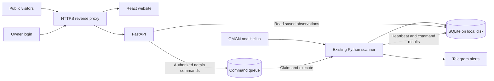

# Revival Radar website plan

Planning date: 11 October 2026. This document describes proposed work; implementation and deployment have not started.

## Product and audience

Build a public website where visitors can discover revival candidates, inspect the evidence behind signals, and review observed post-alert outcomes. Add a private admin area where the owner can monitor and control the existing Telegram bot.

The scanner remains the source of market observations, scores and Telegram delivery. Website traffic reads its saved data. Both Telegram and the admin website will use the same control service when web controls are introduced.

Start with the chains actually enabled in the bot. Solana is the repository default; the existing market-report feature is Solana-only. Public pages describe the bot's tracked universe and show when observations were collected.

## First release

| Page | Visitor experience | Access |
| --- | --- | --- |
| Home / Radar | Short explanation of Revival Radar, latest completed observation time, searchable candidate table, stage and score filters, chain filter, link to Telegram | Public |
| Token details | Contract address, market metrics, score dimensions, reasons, structure, risk findings, missing evidence, observed history and GMGN/explorer links | Public |
| Alerts | Confirmed Telegram signals with their original evidence and subsequent observations | Public |
| Market reports | Existing top-ten Solana ranking for 1h, 4h, 12h, 24h, 72h and 7d; peak versus latest score and coverage | Public |
| Outcomes | Observed returns at +1h, +6h, +24h and +72h, sample counts, median return, pending/missed observations | Public |
| How it works | Explain discovery, Setup/Trigger/Confirmation, stages and data coverage in plain language | Public |
| Admin / Overview | Worker status, scan history, API timing, coverage, delivery failures and near misses | Owner login |
| Admin / Settings | Current configuration, Strict/Balanced/Broad presets, grouped thresholds, chains, exclusions and alert settings | Owner login |
| Admin / Actions | Scan Now, Pause/Resume Alerts and Test Alert, with confirmation and recorded results | Owner login |

The first development milestone provides the public views and private diagnostics in staging. The initial public launch includes working private controls, after their integration tests pass.

### Radar and token details

- Default to candidates at WATCH or above; allow visitors to include lower scores. Show stage, overall score, market cap, liquidity, drawdown, returning activity and observation age. Preserve rejected or risky candidates when the visitor chooses to view them, with visible blockers.
- Search by name, ticker or contract address. Identify every token by chain and contract address; preserve Solana address case.
- Use the latest saved evaluation per token from completed scans. A later market snapshot can appear separately with its own timestamp; it must not silently replace the evidence behind a saved score.
- Show Setup, Trigger and Confirmation as separate 0–100 values, with contribution explanations and structural findings.
- Keep missing values explicit. Unavailable security evidence must remain unknown; a high score must not hide known risk findings.
- Start charts with sampled price/market-cap history and seven-day score history. Offer cached closed 1h candles where they exist, showing their coverage and fetch time. Leave gaps visible and provide an explanatory empty state where candles were never fetched.
- Link directly to the exact token on GMGN and to an explorer where the repository has a supported URL. Allow copying the contract address.

### Alerts, reports and outcomes

- Publish confirmed sent alerts. Keep pending, failed and uncertain delivery records in admin diagnostics. An old alert opens its original saved signal and configuration label; current observations appear separately.
- Reuse the existing report calculation, including completed-scan cutoff, peak/latest distinctions and warnings about sparse or mixed-configuration observations. Keep its current Solana-only, ten-token, seven-day limits visible.
- Calculate outcomes from confirmed sent alerts and known prices. Show the denominator and missing observations beside each statistic. Describe these as observed signal returns; the application does not have executed-trade P&L.

## Visual direction

Use the existing radar icon and its navy/green palette: dark navy surfaces, restrained green accents, amber for incomplete evidence and red for known risks. Use clear stage labels as well as color.

Desktop layout: compact top navigation, summary strip, filter bar and a sortable radar table. Clicking a token opens a dedicated detail page. Mobile layout: readable token cards, compact filters and stacked detail sections. The owner enters a separate admin layout after login.

Keep the primary view focused on finding and assessing tokens. Place explanations beside unfamiliar metrics, and secondary evidence in expandable sections. Include loading, empty, stale-data and failed-request states. Preserve filters in the URL so a visitor can share a filtered radar view.

## Architecture

Recommended stack: React + TypeScript with Vite for the frontend, FastAPI for the Python API, the existing SQLite database initially, and an HTTPS reverse proxy on the bot's host. This reuses the repository's Python models and logic and adds a separately deployable frontend. Vite provides a React/TypeScript starter, and FastAPI integrates with Pydantic. See the [Vite guide](https://vite.dev/guide/) and [FastAPI features](https://fastapi.tiangolo.com/features/).

- Add the frontend under `web/` and the API under `src/revival_radar/web/`. Keep analysis and scoring in their existing modules.
- Run the API separately from the scanner. API startup must not start another scanner or perform database migrations. Give requests their own properly owned connections; never share the scanner's SQLite connection across web request threads.
- Use read-only data connections, bounded queries and short transactions. Use a separate authorized write connection only for admin session/command persistence as needed.
- Keep the database, WAL and shared-memory files on the same local host. WAL supports concurrent readers and a writer, but cannot be shared across hosts through a network filesystem. See [SQLite WAL documentation](https://www.sqlite.org/wal.html).
- Serve the frontend and API under one origin. Use a 30-second browser refresh with backoff and pause polling in hidden tabs. Show observation time independently from page refresh time; the bot's configured scan cadence can be much slower.
- Cache public responses briefly and invalidate/version them by completed scan where useful. Limit page size, chart ranges and request frequency so public traffic cannot exhaust the bot host.
- Website GET requests make no GMGN or Helius calls. Chart requests return stored data; a finer chart-data pipeline is a separately scoped improvement.
- For financial charts, use TradingView Lightweight Charts with its required attribution notice and TradingView link. See the [official project documentation](https://github.com/tradingview/lightweight-charts).

The initial hosting proposal assumes the existing bot host can serve HTTPS. Confirm its resources, domain and reverse-proxy setup before deployment. If the frontend is hosted elsewhere, it still reaches the Python backend over HTTPS; hosted Workers cannot directly run this Python scanner or read its local database.

## API and access boundaries

| API group | Proposed responsibility | Access |
| --- | --- | --- |
| `/api/v1/radar` | Paginated latest evaluations; validated filtering and sorting | Public |
| `/api/v1/tokens/{chain}/{address}` | Latest saved evidence and token metrics | Public |
| `/api/v1/tokens/{chain}/{address}/history` | Bounded snapshots, score observations and available cached candles | Public |
| `/api/v1/alerts` and `/api/v1/alerts/{id}` | Confirmed sent signals and their original evidence | Public |
| `/api/v1/reports` | Existing Solana report for a supported window | Public |
| `/api/v1/outcomes` | Aggregate outcomes with sample/coverage counts | Public |
| `/api/v1/admin/session` | Owner sign-in and sign-out | Authentication flow |
| `/api/v1/admin/status` | Detailed scanner health, heartbeat and delivery status | Owner |
| `/api/v1/admin/settings` | Bot-published allowlisted configuration and revision | Owner |
| `/api/v1/admin/commands` | Submit, preview and inspect authorized control requests | Owner |

Define dedicated response models for public and admin data. Public serialization includes only fields intended for display; it must not return raw `state`, environment settings, Telegram IDs, command records or internal errors.

Use one owner account initially with a hashed password and an authenticated server session. Cookies are HttpOnly, Secure and SameSite; mutation routes require CSRF protection. Protect admin endpoints on the server independently of frontend routing. Include login throttling, session expiry and logout. Keep provider credentials and Telegram credentials in the existing server environment.

## Shared bot controls

This is the main backend integration task. Today, `RuntimeSettings` loads `radar-controls.json` at startup and retains settings and revision in memory. The file also contains the Telegram polling offset. A separate API writing that file would not update the running bot and could overwrite its newer state.

Introduce a durable `web_commands` queue consumed by the existing bot process, plus bot-published status/settings snapshots:

1. The API accepts an authenticated command with an ID, allowlisted action, expected settings revision and validated payload.
2. A background task inside `run_service()` claims commands and calls the same controller used by Telegram. It must continue processing while the scanner waits on upstream requests.
3. Settings validation, previews and changes use the bot's existing `RuntimeSettings` instance. Telegram retains ownership of its polling offset. Apply ordinary strategy changes on the next scan and report saved versus active revision; pause/resume keeps the current delivery-mute behavior.
4. Scan Now uses the existing scan-request event. Return running/queued states and preserve scan non-overlap and provider rate limits.
5. Persist command status, result and actor. Handle stale revision conflicts, duplicate submissions and restart recovery. Settings-file writes and SQLite acknowledgements are separate operations: record the target revision and normalized changes, then reconcile a crash after settings were applied but before acknowledgement. Do not blindly retry an applied change or a Test Alert after an uncertain send.
6. Publish a heartbeat, running/next-scan state and current allowlisted settings from the bot. An unfinished scan row alone cannot establish that the worker is still running.

Preview commands also run through the bot so they reflect the current configuration. Persist a preview ID bound to the owner, exact normalized changes, expected revision and expiry. Confirmation applies that saved payload and rejects expired or conflicting previews. Destructive resets and message-sending actions show a clear confirmation screen.

Preserve Test Alert's existing behavior: send a clearly labeled synthetic example to the owner's private Telegram chat, with no public alert or outcome record.

Add queue storage through a versioned migration; let the scanner's startup own migrations. Back up the database and runtime settings before the upgrade. Verify preservation of alerts, cooldowns, saved evidence, outcomes and Telegram offset. Document whether rollback requires restoring the prior database alongside the prior bot image.

## Delivery sequence and estimates

These are rough engineering estimates for one developer familiar with the repository. They assume an available host/domain and cover implementation plus verification; hosting access or product changes can extend them.

| Milestone | Work and reviewable result | Estimate |
| --- | --- | --- |
| 1. Design and contracts | Responsive Radar and token-detail layouts; public/admin field definitions; proposed API contract and synthetic demo states | 1–2 working days |
| 2. Data API and public views | Query layer, public response models, caching/pagination, Radar, details, alerts, reports, outcomes and explanation page; owner login and diagnostics | 4–6 working days |
| 3. Private controls | Shared controller, command queue, heartbeat, settings preview/confirm, presets, scan/pause/test actions, revision and restart handling | 3–5 working days |
| 4. Verification and launch | Integration/security checks, frontend build, mobile review, scan-load check, backups, HTTPS deployment and rollback guide | 2–3 working days |

Expected complete first release: approximately **10–16 working days**, with a browsable staging dashboard before the control integration is finished. Use synthetic fixtures for early previews and a backup copy of production data for final comparisons.

## Acceptance criteria

- Public visitors can filter candidates, open a token and understand its score, data age, risks and missing evidence on desktop and mobile.
- Saved score/evidence, report ranking and outcome calculations agree with the bot for the same observation, window and configuration. Legacy unknown fields remain unknown.
- Anonymous requests to every admin read/mutation route are rejected. Public responses contain no credentials, owner/Telegram identifiers or internal control data.
- Public browsing produces zero additional upstream provider requests. Representative concurrent browsing does not introduce scan failures or materially worsen measured scan duration; record the before/after comparison.
- Web settings and Telegram settings converge on one revision. Conflicting previews fail cleanly, and normal changes take effect on the next scan without rewriting historical signals.
- Repeated Scan Now clicks never start overlapping scanners. Pause/resume keeps existing signal-delivery behavior; scheduled market reports retain their independent controls.
- Worker outages show stale observations and an unavailable admin heartbeat. Data absence, partial scans, unavailable candles and missed outcomes have explicit UI states.
- Control actions survive or reconcile restart conditions without duplicate message sends. Migration/backup/restore is exercised against a copied database.
- Existing Python checks pass, new API/control tests cover meaningful authorization and concurrency boundaries, and frontend type checking/build and primary user-flow checks pass.

## Later expansion

After the public dashboard and private controls are stable, consider personal favorites and accounts, longer report/score retention, additional-chain reports, dedicated finer candle collection, notifications and subscriptions. Scanner `watch_state` is internal scheduling data; a personal watchlist needs separate user-owned storage.

Move to PostgreSQL when measured traffic or a multi-host deployment requires it. Public data-distribution permissions under the GMGN account should be confirmed before launch. Public search indexing and a larger marketing site can be scoped separately from the operational dashboard.

## GitHub implementation backlog

Tracking issue: [#16 — Launch the public dashboard with private admin controls](https://github.com/nhattruong0204/gmgn-revival-radar/issues/16). Each implementation issue contains scope, dependencies and acceptance criteria. Start with #17; the public data API and shared bot controller can then proceed in parallel.

| Issue | Work |
| --- | --- |
| [#17](https://github.com/nhattruong0204/gmgn-revival-radar/issues/17) | define API contracts and build the responsive application foundation |
| [#18](https://github.com/nhattruong0204/gmgn-revival-radar/issues/18) | implement a bounded read-only public data API |
| [#19](https://github.com/nhattruong0204/gmgn-revival-radar/issues/19) | build the public Radar, token details and history charts |
| [#20](https://github.com/nhattruong0204/gmgn-revival-radar/issues/20) | add public alerts, market reports, outcomes and methodology pages |
| [#21](https://github.com/nhattruong0204/gmgn-revival-radar/issues/21) | protect the private admin area with owner authentication |
| [#22](https://github.com/nhattruong0204/gmgn-revival-radar/issues/22) | extract a shared bot control service from Telegram controls |
| [#23](https://github.com/nhattruong0204/gmgn-revival-radar/issues/23) | add durable admin commands, bot heartbeat and revision snapshots |
| [#24](https://github.com/nhattruong0204/gmgn-revival-radar/issues/24) | build private admin diagnostics, settings and control actions |
| [#25](https://github.com/nhattruong0204/gmgn-revival-radar/issues/25) | validate data parity, access isolation and control recovery |
| [#26](https://github.com/nhattruong0204/gmgn-revival-radar/issues/26) | deploy over HTTPS and document backups, monitoring and rollback |

## Repository basis

- [README](../README.md): current features, deployment and configuration.
- [Repository](../src/revival_radar/storage/repository.py): evaluations, evidence, reports, alerts, health and outcomes.
- [Database](../src/revival_radar/storage/database.py): schema 4, WAL and migrations.
- [Runtime settings](../src/revival_radar/runtime_settings.py): validation, revisions, process-local settings and persistence.
- [Service](../src/revival_radar/service.py): scanner scheduling, immediate mute checks and report scheduling.
- [Enrichment](../src/revival_radar/enrichment.py): selective cached closed 1h candles.
- [Market reports](market-reports.md) and [outcomes](outcomes.md): existing definitions and coverage limits.
